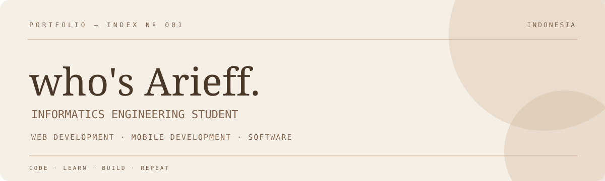

 

 

 

**INFORMATICS ENGINEERING STUDENT · INDONESIA**

Building ideas, learning technologies, and turning curiosity into code.

[GitHub](https://github.com/lionellArieff) · [Repositories](https://github.com/lionellArieff?tab=repositories)

---

<table>
<tr>
<td bgcolor="#80644D" align="center" colspan="2">

**PORTFOLIO — COFFEE BROWN EDITION**

</td>
</tr>
<tr>
<td width="50%" bgcolor="#F5EFE6" valign="top">

### 01 — ABOUT ME

Hi, I'm **Arieff** — an Informatics Engineering student interested in software development and building useful digital products.

I enjoy learning by creating projects, exploring new technologies, and improving one line of code at a time.

</td>
<td width="50%" bgcolor="#E6D5C3" valign="top">

### 02 — CURRENT FOCUS

- Web Application Development
- Mobile Application Development
- Backend Fundamentals
- Problem Solving
- Continuous Learning

</td>
</tr>
</table>

---

<table>
<tr>
<td bgcolor="#80644D" align="center">

**03 — TECHNOLOGY & TOOLS**

</td>
</tr>
<tr>
<td bgcolor="#F5EFE6" align="center">

 

 

</td>
</tr>
</table>

---

<table>
<tr>
<td bgcolor="#80644D" align="center">

**04 — SELECTED REPOSITORIES**

</td>
</tr>
<tr>
<td bgcolor="#F5EFE6">

| PROJECT | DESCRIPTION |
|:---|:---|
| [mobille_2](https://github.com/lionellArieff/mobille_2) | Mobile development project |
| [backend-puddingku](https://github.com/lionellArieff/backend-puddingku) | Backend development project |
| [Arief-Di-Tolak-UGM](https://github.com/lionellArieff/Arief-Di-Tolak-UGM) | Personal project |
| [Tugas-Perpustakaan](https://github.com/lionellArieff/Tugas-Perpustakaan) | Library assignment project |

</td>
</tr>
</table>

---

<table>
<tr>
<td bgcolor="#80644D" align="center">

**05 — GITHUB STATISTICS**

</td>
</tr>
<tr>
<td bgcolor="#F5EFE6" align="center">

</td>
</tr>
</table>

---

<table>
<tr>
<td bgcolor="#493727" align="center">

**THANK YOU FOR STOPPING BY**

Learning · Building · Growing

*Designed with a little coffee-inspired warmth.* ☕

</td>
</tr>
</table>

