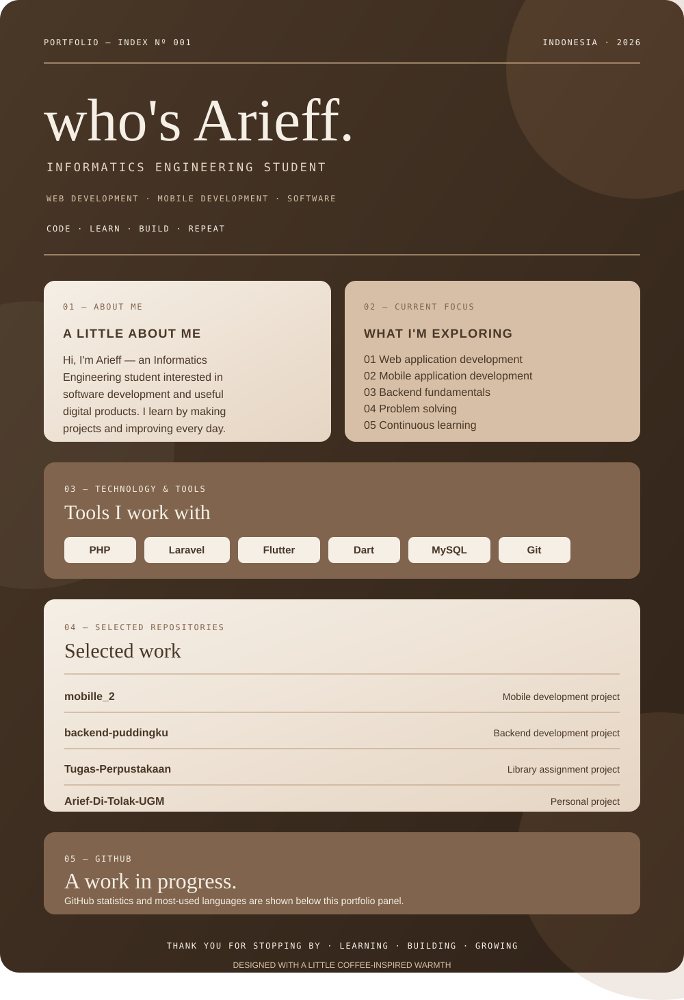

  

<table width="100%" bgcolor="#302319" border="0" cellspacing="0" cellpadding="10">
  <tr>
    <td align="center" colspan="2">
      
    </td>
  </tr>
  <tr>
    <td align="center" colspan="2">
      
    </td>
  </tr>
  <tr>
    <td align="center" colspan="2">
      <b>TERIMA KASIH SUDAH MAMPIR · BELAJAR · MEMBANGUN · BERKEMBANG</b>
    </td>
  </tr>
</table>
